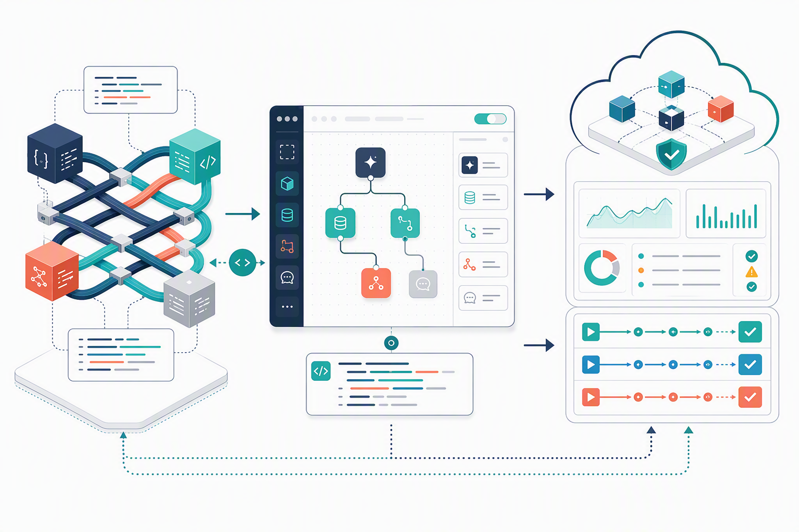

# 製品ポートフォリオ

Devagent社の製品は、コード中心のOSS、視覚的な開発環境、マネージド実行環境の3層で構成されます。

## AgentWeave

PythonとTypeScriptでエージェントを開発するApache License 2.0のOSSフレームワークです。モデル、ツール、メモリ、ワークフロー、評価、トレースを交換可能な部品として扱います。細かな制御、既存開発工程への統合、オンプレミス実行が必要なチームに向きます。

## Devagent Studio

ノーコード/ローコードでエージェントを作る製品です。視覚的なフロー、プロンプト管理、コネクター、評価、共同レビューを提供します。作成結果はAgentWeaveを使用したPythonまたはTypeScriptのAgent Projectとしてエクスポートできます。エクスポート後も特定のRuntimeだけに拘束されません。

## Devagent Runtime

Agent Projectをクラウドで実行するマネージド環境です。デプロイ、バージョン管理、オートスケール、シークレット参照、監視、監査ログ、段階的リリースを提供します。AgentWeaveで直接作ったプロジェクトとStudioから発行したプロジェクトの両方を実行できます。

## 共通原則

1. Studioで始めても、コードを持ち出せる。
2. コードで始めても、Runtimeの運用機能を利用できる。
3. 本番エージェントには評価、監視、責任者を設定する。
4. 顧客データを既定でモデル学習に利用しない。
5. 開発速度だけでなく、変更可能性と運用品質を製品価値に含める。

顧客には「どの製品が上位か」ではなく、チームの技能、統制、配置先、運用責任に合う組み合わせを提案します。