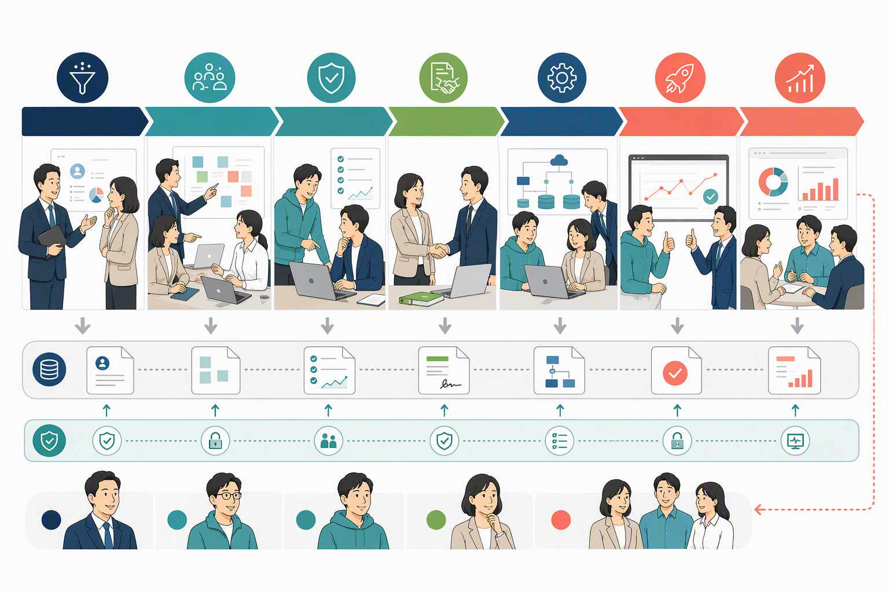

# 顧客導入ライフサイクルの全体像

Devagent社では、商談から定着までを7段階で管理します。段階名よりも、次へ進むための完了条件が重要です。

| 段階 | 主担当 | 次へ進む条件 |
| --- | --- | --- |
| 1. Qualify | Sales | 顧客課題、意思決定者、予算時期、次の技術確認がDealDeckにある。 |
| 2. Discover | Sales + Solution Engineering | ユースケース、データ、統合先、成功指標、リスクが合意されている。 |
| 3. Validate | Solution Engineering | 技術検証とセキュリティ確認が完了し、実現可能性を説明できる。 |
| 4. Commit | Sales | 契約、導入範囲、責任分界、FDE引き継ぎ条件が確定している。 |
| 5. Implement | FDE | LaunchPadの計画に沿って構築、評価、運用設計が完了している。 |
| 6. Go live | FDE + 顧客 | 本番判定、監視、障害時連絡、ロールバック、利用者教育が完了している。 |
| 7. Adopt | Sales + FDE + Product | 成功指標を定期確認し、改善要求が製品フィードバックへ接続されている。 |

## 共通ルール

DealDeckは顧客、商談、契約、主要な意思決定の記録に使います。LaunchPadは契約後の導入計画、成果物、リスク、承認に使います。同じ情報を別々に保つ場合は、どちらが正かを明記します。

前段階の未解決事項を隠して次へ進めません。期限、責任者、顧客影響を記録した上で、次段階の責任者が受け入れた場合に限り、既知のリスクとして持ち越せます。

製品への要望は、顧客との約束と製品ロードマップを分けて管理します。Sales、Solution Engineering、FDEはPMの確認なしに未提供機能の提供日を約束しません。